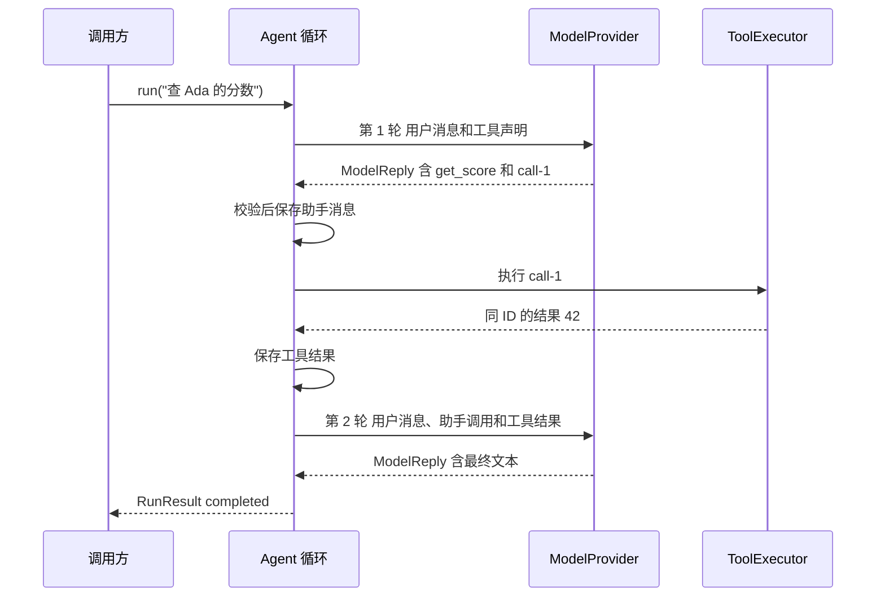

# TuAgent 源码学习指南

**模型提出工具调用，Agent 校验并执行，模型拿到结果后继续生成回答。** 第一次读 TuAgent，先跟完这次工具往返，再看轮数上限、取消、续跑和真实模型接入。本文对应 `tuagent` 0.3.0。

## 学习顺序

| 顺序 | 先看哪里 | 读完要能回答的问题 |
| --- | --- | --- |
| 1. Agent loop | [`test_loop.py`](../tests/test_loop.py) 中的 `test_final_reply_uses_tool_output_under_either_registered_name`，再读 [`loop.py`](../src/tuagent/loop.py) 的 `_run_turn()` | 为什么要请求模型两次？第二次请求比第一次多了哪些消息？ |
| 2. 消息与工具 | [`messages.py`](../src/tuagent/messages.py)、[`model.py`](../src/tuagent/model.py)、[`registry.py`](../src/tuagent/tools/registry.py)、[`executor.py`](../src/tuagent/tools/executor.py) | 工具名、调用 ID 和 JSON 参数各在哪一步使用？参数出错时，谁将错误回给模型？ |
| 3. 运行生命周期 | [`agent.py`](../src/tuagent/agent.py)、[`events.py`](../src/tuagent/events.py)、[`test_lifecycle.py`](../tests/test_lifecycle.py) | 什么时候可以提交历史？取消时如何配齐结果？为什么续跑可以跳过已经执行的工具？ |
| 4. 供应商适配 | [`chat_completions.py`](../src/tuagent/providers/chat_completions.py) 和 [`test_provider.py`](../tests/test_provider.py) | 如何从交错的流式分片还原工具调用？同一份内部历史在 HTTP 请求里长什么样？ |

只想先掌握 Agent 开发的基本功，读完前两步并跑通下面的例子就够了。之后用取消回归理解可靠运行，再到适配器看怎么把同一个循环接到真实模型。

## 项目目录

```text
TuAgent/
├── pyproject.toml                  构建、版本、Python 版本和可选依赖
├── .gitignore                      忽略本地产物和 .env.local
├── docs/
│   ├── agent-core-plan.md          M1 至 M3 的开发计划与验收记录
│   └── agent-learning-guide.md    源码学习指南
├── src/tuagent/
│   ├── __init__.py                 包的公共导入入口
│   ├── agent.py                    会话、运行入口和任务管理
│   ├── loop.py                     模型轮次、历史写入和工具批次
│   ├── messages.py                 会话消息和运行结果
│   ├── model.py                    模型协议和模型可见的数据
│   ├── events.py                   对调用方发布的运行事件
│   ├── py.typed                    声明包提供类型注解
│   ├── tools/
│   │   ├── __init__.py             工具公共类型的导出入口
│   │   ├── registry.py             工具定义、注册和快照
│   │   └── executor.py             参数校验、handler 执行和结果归一化
│   └── providers/
│       ├── __init__.py             适配器的导出入口
│       └── chat_completions.py     Chat Completions 流式协议转换
└── tests/
    ├── fakes.py                    可编排回复的离线模型
    ├── test_loop.py                通过 Agent 公共入口验证循环
    ├── test_tools.py               注册、校验、执行与工具错误
    ├── test_lifecycle.py           取消、事件、截断和续跑
    ├── test_provider.py            用 HTTP/SSE 样本验证协议映射
    └── live_chat_completions.py    显式运行的真实端点验收
```

`Agent` 持有一份内存会话，并为每次运行创建 `_RunLoop`。循环通过 `ModelProvider` 获得回复，通过 `ToolExecutor` 执行工具。脚本模型和真实适配器都实现同一个 `stream()` 接口，因此循环测试可以离线完成。项目使用 Python 3.11+，基础依赖是 Pydantic，OpenAI SDK 由 `chat-completions` extra 引入。 [构建配置](../pyproject.toml) · [开发计划](agent-core-plan.md)

## 一次工具调用怎样跑完

下面以“查 Ada 的分数”为例。`get_score` 是示例里临时注册的 Python 函数。模型生成工具名和参数后，Agent 才能查到对应函数。



读第二次模型请求时，按消息顺序找下面三个对象。系统提示和工具声明在 `ModelRequest` 的独立字段里。

```python
(
    UserMessage("查 Ada 的分数"),
    AssistantMessage(tool_calls=(ToolCall("call-1", "get_score", '{"player":"Ada"}'),)),
    ModelToolResult("call-1", "42", False),
)
```

- `name` 用于在注册表里找到 handler。多个调用可以使用同一个工具名。
- `id` 用于将每个调用与它的结果配对。注册表按工具名分派，消息历史按调用 ID 配对。
- `arguments` 保存模型输出的原始 JSON 字符串。执行器校验后给 handler 一个 Pydantic 对象。供应商适配器可以用原字符串回放助手消息。
- `ToolDeclaration` 包含模型可见的名称、说明和 JSON Schema。可执行函数与调用方的 Python 上下文留在本地。

**运行、轮次和工具调用**是三个不同的范围。一次 `run()` 或 `continue_run()` 创建一次运行。一次模型请求对应一个轮次，一轮可能包含零个或多个工具调用。一轮执行完一批工具后，循环才会发出下一次模型请求。直接回答通常只需一轮。`RunResult.messages` 是本次新增的消息，`agent.history` 是当前 Agent 的完整会话。

## 中断时怎样维护会话

流式文字通过 `text_delta` 事件供界面实时展示。循环等到 `ModelReply` 到达、流结束并通过校验后，才写入助手消息。工具批次开始前，整批调用的结构都会检查。通过结构检查后，每个调用再各自做 JSON 和参数校验。

| 情况 | 循环如何处理 |
| --- | --- |
| 同批调用 ID 重复或调用字段类型错误 | 此轮返回 `failed`，助手消息留在本轮草稿中，整批 handler 执行零次。 |
| 调用结构合法，但工具未知、JSON 损坏、参数无效或 handler 报错 | 写入同 ID 的工具错误。同批其他调用继续执行，模型下一轮可以看到这些结果。 |
| 流结束时缺完整回复，或读取抛出异常 | 分别返回 `model_stream_incomplete` 或 `model_error`，保留先前已提交的消息。 |
| 模型以 `length` 结束 | 纯文本保留已有文字并返回 `incomplete`。含有合法工具调用时，为这些调用逐个写 `truncated`，工具执行零次，剩余轮数允许时再请求模型。 |
| 工具批次取消 | 已确认结果立即保留。执行中的调用记为 `outcome_unknown`，未开始的调用记为 `not_started`。 |
| 工具批次结束后用尽轮数 | 保留最后一批结果，返回 `turn_limit`。如果最后一轮已拿到完整文本答案，则返回 `completed`。 |

`agent.abort()` 请求工作 Task 取消。主动取消完成后，`run()` 返回 `cancelled` 结果。调用方直接取消外层 Python Task 时，`asyncio.shield()` 让工作 Task 有机会补齐历史。外层 Task 等清理完成后继续传播 `CancelledError`。循环还会在工具分派前检查外层 Task 的取消计数，覆盖“第一个工具刚被唤醒，下一个工具还没开始”的时序。

`continue_run()` 允许从用户消息或配齐的工具结果处继续。它会核对历史中调用与结果的 ID 和顺序。续跑创建新的运行，从现有历史请求模型。先前已经执行的调用对应的是历史消息，新一轮只处理新回复中提出的调用。

## 运行时逐函数索引

### 会话入口和任务管理

源码在 [`agent.py`](../src/tuagent/agent.py)。

| 成员 | 职责 |
| --- | --- |
| `Agent.__init__()` | 接收模型、系统提示、注册表、工具上下文和轮数上限。默认创建空注册表，轮数上限为 16，要求传入正整数。 |
| `Agent.history` | 返回当前历史的元组，供调用方读取。 |
| `Agent.run()` | 将输入包装成 `UserMessage`，进入负责实际运行的 `_run()`。 |
| `Agent.abort()` | 将取消请求转交给当前 `_RunLoop`。 |
| `Agent.continue_run()` | 传入空的新增用户消息，从现有历史开始运行。 |
| `Agent._run()` | 拒绝同一 Agent 的并发运行并校验续跑条件，创建工具执行器和工作 Task。等待工作 Task 收尾后释放当前运行。 |

### 一次运行的循环

源码在 [`loop.py`](../src/tuagent/loop.py)。`_Outcome` 是内部临时结果，保存状态、文本和错误码，最后组装为公开的 `RunResult`。

| 成员 | 职责 |
| --- | --- |
| `_RunLoop.__init__()` | 绑定会话历史、模型、执行器和观察者，生成 `run_id`，记录调用方 Task 的初始取消计数。 |
| `_RunLoop.abort()` | 幂等地标记取消，以事件循环回调安排取消工作 Task。 |
| `_RunLoop._check_abort()` | 检查显式取消和调用方的新取消请求，必要时在当前边界抛出 `CancelledError`。 |
| `_RunLoop.execute()` | 发出 `run_start`，记录历史起点，按需提交用户消息并推进循环。在 `finally` 中发出一次 `run_end`，再按正常返回路径构造 `RunResult`。 |
| `_RunLoop._advance()` | 在轮数预算内反复运行 `_run_turn()`，在每轮前后发事件。收到终态或用尽预算时结束。 |
| `_RunLoop._run_turn()` | 构造请求并读取完整回复，校验停止原因和整批调用，提交助手消息，再决定返回结果、处理截断或执行工具。 |
| `_RunLoop._read_reply()` | 消费提供方的异步事件流。转发文本增量，收集唯一的终止回复，检查其后是否还有事件，并在退出时关闭支持 `aclose()` 的流。 |
| `_RunLoop._execute_tools()` | 按顺序执行这一批工具，逐条写结果。取消时为批次中余下的调用补齐合适的错误结果。 |
| `_RunLoop._record_tool_result()` | 提交一条工具结果，再发出含同调用 ID 的 `tool_end` 事件。 |
| `_RunLoop._commit()` | 将消息追加到历史，用模型可见的消息投影发出 `message` 事件。 |
| `_RunLoop._emit()` | 生成带运行 ID 和递增序号的事件，调用同步观察者。观察者异常会记日志。 |
| `_tool_call_error()` | 检查每个调用的类型、ID 是否有效且同批唯一、名称和参数是否为字符串。返回结构错误码或 `None`。 |
| `_can_continue()` | 用队列按顺序消费每批助手调用期待的结果 ID，并检查尾部是否处于可续跑边界。 |

### 消息和模型接口

数据类型定义在 [`messages.py`](../src/tuagent/messages.py) 和 [`model.py`](../src/tuagent/model.py)。

看异步代码时可以从 `yield` 和 `return` 入手。模型的 `stream()` 用 `async def` 加 `yield` 逐条产出事件，循环用 `async for` 消费它们。handler 用 `async def` 加 `return` 交付一个 `ToolOutput`，执行器用 `await` 等待它。这两个接口对应一份流式回复和一次具体的工具执行。

| 成员 | 职责 |
| --- | --- |
| `UserMessage` | 保存用户输入文本。 |
| `ToolCall` | 保存调用 ID、工具名和原始参数 JSON 字符串。 |
| `AssistantMessage` | 保存助手文字和零个或多个工具调用。它的 `__post_init__()` 将工具调用转成元组。 |
| `ToolResultMessage` | 保存调用 ID、正文、错误标记，以及供本地代码读取的错误码和 `details`。 |
| `Message`、`RunStatus` | 分别限定历史消息类型和运行的五种结束状态。 |
| `RunResult` | 返回状态、本次新增消息、请求轮数、可用回答文本和错误码。 |
| `ModelToolResult` | 工具结果的模型可见形式，仅含调用 ID、正文和错误标记。 |
| `ModelMessage` | 模型可见的用户消息、助手消息或工具结果。 |
| `ModelRequest` | 保存系统提示、模型可见的历史和工具声明，作为模型的一轮输入。 |
| `ModelTextDelta`、`ModelReply`、`ModelEvent` | 前两者分别表示文字片段和带停止原因的完整助手消息。`ModelEvent` 是两者的联合类型。 |
| `ModelProvider.stream()` | 规定模型接收 `ModelRequest`，返回异步事件流。实现类只要满足这个接口，就可以传入 `Agent`。 |
| `_project_message()` | 将工具消息转换为 `ModelToolResult`，用户和助手消息直接沿用。 |
| `_build_request()` | 投影整份历史，组合系统提示和工具声明，创建本轮请求。 |

[`events.py`](../src/tuagent/events.py) 定义了 `RunEventKind` 和冻结的 `RunEvent`。`EventHandler` 是 `Callable[[RunEvent], None]`。例如，把 `on_event=events.append` 传给 `run()`，即可按顺序查看事件。`run_id` 标识本次运行，`sequence` 从 1 递增，适用时会附上轮次、调用 ID、消息投影或文本片段。`run_end` 带运行状态。

### 工具注册与执行

源码在 [`registry.py`](../src/tuagent/tools/registry.py) 和 [`executor.py`](../src/tuagent/tools/executor.py)。Pydantic 参数类同时用于生成给模型看的 JSON Schema 和校验运行时入参。handler 的约定是 `async def handler(args, ctx) -> ToolOutput`。

| 成员 | 职责 |
| --- | --- |
| `ToolContext` | 向 handler 提供本次调用 ID 及 Agent 注入的可选上下文。 |
| `ToolOutput` | handler 产出的文本、可选本地详情和错误标记。 |
| `ToolDeclaration` | 模型可见的工具名、说明和参数 Schema。 |
| `Args`、`_RegisteredTool` | `Args` 是受 `BaseModel` 约束的类型变量。注册记录将声明、参数类和异步 handler 绑定在一起。 |
| `ToolRegistry.__init__()` | 创建按名称索引的空字典。 |
| `ToolRegistry.register()` | 拒绝重复名称，用 `model_json_schema()` 生成声明并保存注册记录。 |
| `ToolRegistry._snapshot()` | 对注册字典做浅拷贝，供单次运行使用。运行期间新增的注册会在下次运行生效。 |
| `ToolExecutor.__init__()` | 保存注册快照和调用方传入的工具上下文。 |
| `ToolExecutor.declarations()` | 返回声明的深拷贝，供每轮请求使用。 |
| `ToolExecutor.execute()` | 按名查找工具，调用 `model_validate_json()` 校验参数，等待 handler，生成同 ID 的 `ToolResultMessage`。 |
| `_tool_error()` | 用原调用 ID、错误码和可读正文构造错误工具结果。循环的取消和截断分支也使用它。 |

### Chat Completions 适配器

源码在 [`chat_completions.py`](../src/tuagent/providers/chat_completions.py)。流中的 `index` 指向同一回复中的工具位置，`id` 关联后续工具结果。适配器用前者组装参数，用后者构造会话消息。函数名和调用 ID 当作元数据保留，参数片段按到达顺序拼接。

| 成员 | 职责 |
| --- | --- |
| `ChatCompletionsProtocolError` | 表示供应商流中的数据无法表示为支持的模型回复，例如缺调用 ID 或停止原因未受支持。 |
| `_RequestOptions` | 描述发送请求时可选的 `tools` 字段。空工具集省略该字段。 |
| `ChatCompletionsProvider.__init__()` | 保存模型名、调用方管理的异步客户端和可选扩展参数，阻止扩展参数覆盖模型、消息、工具或流开关。 |
| `ChatCompletionsProvider.stream()` | 构造流式请求，发出 `ModelTextDelta`，收集各工具的入参片段。流正常迭代完毕且已收到有效停止原因时，按索引组装并发出完整 `ModelReply`。 |
| `_serialize_message()` | 将内部消息映射为 `user`、`assistant`、`tool` 三种角色。工具错误的正文加上 `Tool error:`，成功时直接传递正文。 |
| `_serialize_tool()` | 将工具名、描述和参数 Schema 写入 Chat Completions 的 `function` 工具声明。 |
| `_ToolCallParts` | 临时保存单个索引的工具 ID、函数名和参数片段。 |
| `_ToolCallParts.append()` | 校验工具类型，合并 ID 和名称，追加参数片段。 |
| `_ToolCallParts.to_call()` | 检查 ID 和函数名齐备，将参数片段拼成字符串并创建 `ToolCall`。 |
| `_merge_metadata()` | 沿用已收到的元数据，接受相同的重复值，拒绝冲突值。 |

[`src/tuagent/__init__.py`](../src/tuagent/__init__.py) 汇集常用公共接口。[`tools/__init__.py`](../src/tuagent/tools/__init__.py) 和 [`providers/__init__.py`](../src/tuagent/providers/__init__.py) 分别汇集工具接口和适配器接口。

## 跑一个离线例子

从项目根目录安装基础包，再把下面的 Python 代码保存为临时脚本运行。

```powershell
python -m pip install -e .
```

```python
import asyncio
from collections.abc import AsyncIterator

from pydantic import BaseModel
from tuagent import (
    Agent, AssistantMessage, ModelEvent, ModelReply, ModelRequest,
    ModelToolResult, ToolCall, ToolContext, ToolOutput, UserMessage,
)


class ScoreArgs(BaseModel):
    player: str


async def get_score(args: ScoreArgs, ctx: ToolContext) -> ToolOutput:
    print("执行工具", ctx.tool_call_id, args.player)
    return ToolOutput("42")


class DemoModel:
    async def stream(self, request: ModelRequest) -> AsyncIterator[ModelEvent]:
        last = request.messages[-1]
        if isinstance(last, UserMessage):
            call = ToolCall("call-1", "get_score", '{"player":"Ada"}')
            yield ModelReply(AssistantMessage(tool_calls=(call,)), "tool_calls")
            return
        assert isinstance(last, ModelToolResult)
        print("模型收到结果", last.tool_call_id, last.content)
        yield ModelReply(AssistantMessage(f"Ada 的分数是 {last.content}"))


async def main() -> None:
    agent = Agent(DemoModel())
    agent.tools.register("get_score", "查询玩家分数", ScoreArgs, get_score)
    result = await agent.run("查 Ada 的分数")
    print(result.status, result.turns, result.text)


asyncio.run(main())
```

第一次运行会看到工具只执行一次，最后一行是 `completed 2 Ada 的分数是 42`。把 handler 的返回值改成 `99`，观察第二轮如何使用新值。把原例中的 `Agent(DemoModel())` 改成 `Agent(DemoModel(), max_turns=1)`，观察状态变成 `turn_limit` 后，工具结果在历史的哪个位置。在 `main()` 最后加上 `print((await agent.continue_run()).text)`，看最终文字如何从这个已有结果生成。

## 用测试验证理解

建议从实际工具往返的单个用例开始。它用私有 `details` 和自定义上下文，检查传给模型的内容与调用方本地数据的边界。

```powershell
python -m unittest discover -s tests -p test_loop.py -k final_reply -v
```

安装可选依赖后，可以用原始 HTTP 样本检查工具往返。两个 HTTP 请求都由 `httpx.MockTransport` 在进程内处理。真实端点验收单独运行，命令见 [M3 验收记录](agent-core-plan.md#m3--真实模型适配独立集成阶段)。

```powershell
python -m pip install -e ".[chat-completions]"
python -m unittest discover -s tests -v
```

### 测试替身和验收脚本

| 文件和成员 | 作用 |
| --- | --- |
| [`fakes.py`](../tests/fakes.py) 的 `Step`、`ScriptedModel.__init__()` | `Step` 可以是一条事件、多条事件、生成事件的函数或 `None`。构造函数保存脚本迭代器和请求记录。 |
| `ScriptedModel.stream()` | 记录收到的 `ModelRequest`，取出并播放下一步脚本，便于断言第二次请求的确切内容。 |
| [`test_provider.py`](../tests/test_provider.py) 的 `_chunk()`、`_frame()`、`_sse()` | 分别构造单选择增量帧、带指定 `choices` 的 SSE 帧和完整 HTTP 响应。 |
| `_BrokenStream.__init__()`、`__aiter__()`、`aclose()` | 保存待发送帧，发完后模拟网络中断，并记录响应流是否关闭。 |
| `ChatCompletionsTests.client()` | 使用假地址、假密钥和 `MockTransport` 创建真正的 SDK 客户端，测试实际序列化路径。 |
| [`live_chat_completions.py`](../tests/live_chat_completions.py) 的 `_read_key()` | 从本地环境变量或指定的本地文件读取验收凭据。 |
| `_verify()` | 跑直接回答和工具往返，核对实际 HTTP 请求次数、第二次请求的调用配对和最终答案，输出 JSON 验收结果。 |
| `record_request()`、`record_response()`、`issue_proof()` | 分别记录请求正文、响应状态码，并为当次工具调用生成新的验收值。 |

### 循环和工具用例

| 用例 | 验证点 |
| --- | --- |
| `test_direct_reply_with_only_a_provider` | 仅需模型就能在一轮内直接回答。 |
| `test_final_reply_uses_tool_output_under_either_registered_name` | 改工具名仍能分派。改 handler 的返回值会改变最终回答。 |
| `test_sequential_runs_share_session_history` | 同一个 Agent 的后续运行能读到已有会话。 |
| `test_turn_limit_preserves_the_last_tool_result` | 达到轮数上限时保留最后一批工具结果。 |
| `test_text_reply_completes_on_the_last_allowed_turn` | 最后一轮收到完整文本时正常完成。 |
| `test_turn_limits_must_be_positive_integers` | 轮数上限必须为正整数。 |
| `test_incomplete_model_stream_keeps_the_user_message` | 流缺少完整回复时保留用户消息。 |
| `test_concurrent_run_leaves_the_active_run_in_charge` | 同一 Agent 只允许一个运行持有会话。 |
| `test_duplicate_name_is_rejected` | 注册同名工具会报错。 |
| `test_invalid_arguments_and_unknown_tools_do_not_execute` | 坏 JSON、非法入参和未知工具生成同 ID 错误，handler 执行零次。 |
| `test_tool_batch_returns_ordered_results_after_a_handler_error` | handler 异常和显式工具错误均能回传，同批后续工具继续按顺序运行。 |
| `test_invalid_call_ids_reject_the_whole_batch` | 空 ID 或同批重复 ID 会拒绝整批调用。 |
| `test_registration_during_a_run_only_applies_to_later_runs` | 本次运行固定工具快照，下次运行可看到新工具。 |

### 运行生命周期用例

| 用例 | 验证点 |
| --- | --- |
| `test_caller_cancel_after_tool_is_released_prevents_next_dispatch` | 第一个工具就绪后立即取消外层 Task，保留第一个结果并跳过第二个 handler。 |
| `test_task_cancellation_keeps_the_first_result_and_pairs_the_second` | 等待中的工具被取消，重复取消仍允许它完成异步清理，调用方最终收到 `CancelledError`。 |
| `test_abort_settles_unstarted_calls_and_continues_without_reexecution` | 主动取消补齐批次，续跑直接使用已写入的结果。 |
| `test_abort_closes_the_model_stream_and_allows_user_message_continuation` | 等模型时取消，关闭模型流并可从用户消息续跑。 |
| `test_observer_can_abort_at_assistant_commit_before_any_tool_starts` | 观察到助手消息提交时可发起取消，尚未开始的工具记为 `not_started`。 |
| `test_continue_rejects_empty_or_completed_history_without_starting_a_run` | 空历史和正常结束的助手消息尾部不能续跑。 |
| `test_continue_rejects_unpaired_tool_results_before_requesting_model` | 缺失、错序、错 ID 或多出的结果会在请求前被拒绝。 |
| `test_disconnect_preserves_settled_history_and_continue_only_requests_model` | 模型断开时保留之前已结算的批次，续跑时每个已完成的调用仍只执行一次。 |
| `test_malformed_second_call_rejects_entire_batch` | 第二个调用结构错误也能阻止第一个 handler 启动。 |
| `test_tool_calls_stop_reason_requires_at_least_one_call` | `tool_calls` 停止原因要求至少有一个调用。 |
| `test_length_skips_the_entire_batch_even_with_valid_json` | 即使截断回复里的参数恰好是合法 JSON，整批工具执行次数仍为零。 |
| `test_text_only_length_returns_partial_text_as_incomplete` | 纯文本截断保留部分文字，状态为 `incomplete`。 |
| `test_events_are_ordered_read_only_and_project_tool_results` | 事件只读、顺序可追踪，结果事件使用模型可见的投影。 |
| `test_model_event_after_terminal_reply_cannot_trigger_tools` | 完整回复之后又收到事件时，拒绝提交助手消息和工具执行。 |

### 模型适配用例

| 用例 | 验证点 |
| --- | --- |
| `test_text_deltas_and_terminal_reply` | 检查发出的请求与文本增量、完整回复的对应关系。 |
| `test_agent_sends_back_interleaved_calls_with_text_and_original_ids` | 交错到达的两个工具调用按索引重组，第二次真实序列化的请求包含原助手调用和正确配对的结果。 |
| `test_length_preserves_tool_id_and_skips_execution` | 截断保留调用 ID，返回带原 ID 的错误工具消息。 |
| `test_disconnect_leaves_complete_looking_drafts_unexecuted` | 流缺结束原因，或在结束帧后发生传输错误时，草稿均不会触发工具。 |
| `test_missing_call_id_is_a_protocol_error` | 缺少供应商调用 ID 的工具回复被显式拒绝。 |

测试里还定义了一些只为当前用例服务的小函数。`test_loop.py` 的 `lookup()` 提供替换值，`answer_from_result()` 从第二次请求读取这个值。`count()` 记录每次调用收到的计数值，`request_next_call()` 让模型持续提出调用。`WaitingModel.stream()` 用事件暂停模型，给并发运行检查留出时机。`test_tools.py` 中各 `handler()` 记录调用、返回正常或错误结果，`add_tool()` 则在第一次模型请求中新增注册。

生命周期用例里的 `first()`、`second()`、`work()`、`save()` 和 `read()` 模拟立即返回、等待、清理或带本地详情的工具。`PausedModel.stream()` 模拟可以等待和关闭的模型流，`observe()` 在收到助手消息时取消运行，`disconnect()` 抛出连接异常。适配器用例里的 `handle()` 读取实际 HTTP 请求并返回预设 SSE 帧。其 `lookup()` 返回按入参构造的值，`work()` 记录截断与断流场景是否误执行工具。
